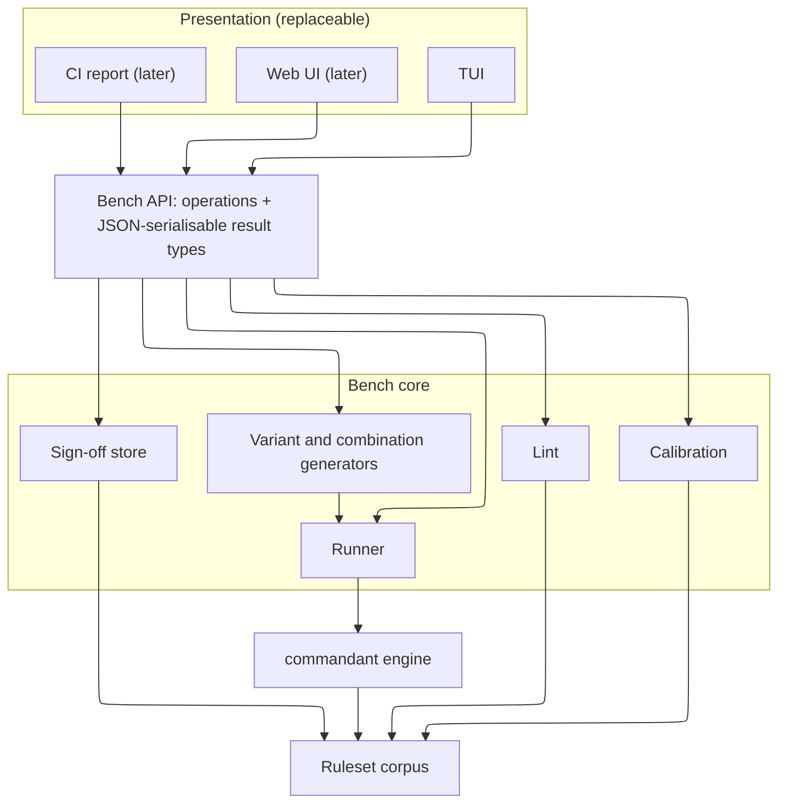

# Bench Design

**Status:** M1–M4 implemented (sections 3–5, 7 and 9–12, without combinations); later milestones are design only.

## 1. Purpose

A ruleset reviewer must answer four questions about every rule:

&nbsp;|Question                 |What it asks                                                               
------|-------------------------|---------------------------------------------------------------------------
Q-a   |True?                    |Are the description and claimed behaviour right for the tool version cited?
Q-b   |Catches the right things?|Does the rule fire on the commands it should, and only those?              
Q-c   |Calibrated?              |Is its severity consistent with similar rules across the corpus?           
Q-d   |Honest?                  |Do its `notes` admit the gaps it has?                                      

Q-b and Q-c are where review time goes, and both are hard to answer by reading JSON. The bench answers their mechanical parts by running commands through the real engine and comparing rules across the corpus. The reviewer judges results instead of imagining them.

## 2. Architecture



The API is in-process Crystal. A web UI later wraps the same calls in an HTTP server that returns the result types as JSON. The core never writes to a terminal.

## 3. API operations

```crystal
bench = Commandant::Bench::Workbench.new(Path["../commandant-rules-core/rulesets"])

bench.rulesets                          # => Array(RulesetRef)                      M1
bench.rules(ruleset)                    # => Array(RuleRef)                         M1
bench.report(rule)                      # => RuleReport                             M1
bench.report(ruleset)                   # => Array(RuleReport), one per rule        M1
bench.try("rm -Rf build/", platform)    # => Actual: one ad hoc command             M1
bench.calibration(rule)                 # => Calibration, with siblings             M3
bench.lint(ruleset)                     # => Array(LintFinding); bench.lint for all  M3
bench.sign_off(report, reviewer, answers) # => SignOff, recorded in the review store M4
bench.status(rule)                      # => ReviewStatus; bench.statuses(ruleset)  M4
```

`RulesetRef` names a ruleset file by folder and tool (`posix/rm`). `RuleRef` adds a rule id (`posix/rm#rm-recursive-force`), or `#default` for the default rule.

## 4. Result types

Type          |Fields                                                                                                                                                             
--------------|-------------------------------------------------------------------------------------------------------------------------------------------------------------------
`RuleReport`  |`rule`, `rule_hash`, `description`, `severity`, `reversible`, `risk_tags`, `notes`, `rows`, `lint`, `calibration`, `review`, `engine_version`; later `combinations`
`BenchRow`    |`command`, `origin`, `subject`, `expectation`, `actual`, `outcome`                                                                                                 
`Origin`      |`example` (index) \| `variant` (kind, parent example) \| `combination` (flags)                                                                                     
`Subject`     |`rule` \| `engine`: which component a miss on this row implicates                                                                                                  
`Expectation` |`fires` \| `does_not_fire` \| `at_least` (severity)                                                                                                                
`Actual`      |`platform`, `binary`, `tool_known`, `ruleset_tool`, `fired_rules`, `severity`, `default_kind`, `resolved_ruleset`                                                  
`Outcome`     |`ok` \| `miss` \| `false_alarm` \| `skipped` (with reason)                                                                                                         
`Calibration` |`siblings`, `close`, `usual`, `usual_count`, `outlier`                                                                                                             
`SiblingRule` |`rule`, `risk_tags`, `severity`, `reversible`, `overlap`                                                                                                           
`LintFinding` |`ruleset`, `rule_id`, `field`, `check`, `level` (`error` \| `advice`), `message`                                                                                   
`ReviewStatus`|`state` (`unreviewed` \| `approved` \| `changes-requested` \| `lapsed`), `sign_off`                                                                                

All types include `JSON::Serializable`. Severities serialise as written in rulesets (`ERROR`).

`fired_rules` covers the primary command only, because the engine does not report rules fired inside compound commands. That is why wrapper variants are judged by severity.

### A row checks this rule, not the verdict

A row's outcome depends on whether *this rule* is among `fired_rules`, not on the final severity. Otherwise a different rule firing at ERROR would hide this rule's miss. The exception is `at_least` rows (section 5), which test the engine's handling of wrappers, where another ruleset legitimately takes over.

## 5. Rows: examples and variants

1. **Examples** come from the rule's `examples` (section 8.1): commands it should fire on and commands it should not. Subject: `rule`.
2. **Variants** are generated from each `fires` example. Each kind has a fixed subject and expectation:

Kind        |Example transform                     |Subject|Expectation|Needs               
------------|--------------------------------------|-------|-----------|--------------------
`reorder`   |`rm -r -f x` → `rm -f -r x`           |rule   |fires      |—                   
`split`     |`rm -rf x` → `rm -r -f x`             |rule   |fires      |—                   
`combine`   |`rm -r -f x` → `rm -rf x`             |rule   |fires      |—                   
`alias`     |`rm -r x` → `rm -R x`                 |rule   |fires      |flag declaration    
`long`      |`rm -r x` → `rm --recursive x`        |rule   |fires      |flag declaration    
`abbrev`    |`rm --recursive x` → `rm --recur x`   |rule   |fires      |flag declaration    
`quote`     |`rm -rf build` → `rm -rf 'build'`     |engine |fires      |—                   
`env-prefix`|`rm -rf x` → `FOO=1 rm -rf x`         |engine |fires      |—                   
`abs-path`  |`rm -rf x` → `/bin/rm -rf x`          |engine |fires      |—                   
`exe-suffix`|`rm -rf x` → `rm.exe -rf x` (Windows) |engine |fires      |tool runs on Windows
`cmd-exe`   |same command, `Platform::Windows::Cmd`|engine |fires      |tool runs on Windows
`compound`  |`rm -rf x` → `cd y && rm -rf x`       |engine |at_least   |—                   
`sudo`      |`rm -rf x` → `sudo rm -rf x`          |engine |at_least   |—                   
`shell-wrap`|`rm -rf x` → `sh -c 'rm -rf x'`       |engine |at_least   |—                   

A kind whose data is missing is reported as `skipped` with the reason, never silently omitted. A visible gap is part of the review.

Until the flag declaration exists (M5), `split` uses the flags a ruleset mentions in its matches to tell `-rf` from a word flag like `-exec`, and `reorder` assumes leading flags take no value. Both are heuristics; the generated command is always shown, so a nonsensical variant is visible.

The `subject` routes findings: a miss on a `rule` row is a ruleset fix; a miss on an `engine` row is a `commandant.cr` fix that no ruleset edit can solve.

## 6. Combination bench

For a ruleset's declared flags, the bench generates every pair and records which rules fire and the resulting severity. A combination is `novel` when it fires a rule that neither flag fires alone. The core returns all pairs; presentation decides how to filter and sort. Thirty flags give 435 pairs, which is cheap to compute.

The reviewer's question is: which pairs are dangerous together but resolve only to their individual rules, or to the baseline default?

## 7. Runner

1. **Fresh `Assessor` per row.** `PersistenceTracker` keeps state across `assess` calls; reusing an assessor would make later rows depend on earlier ones.
2. **The ruleset under review is the one evaluated.** Resolution is first-match-wins, so assessing `posix/rm.json` on a Linux platform would load `linux/rm.json` if it existed. `rule`-subject rows therefore run against a store containing only the file under review. `engine`-subject rows run against the full corpus, since that is what users get, and record `resolved_ruleset`.
3. **Constraints are neutralised.** `allowed_tools` contains the tool under review plus any wrapper the variant adds; `sandbox_root` is a fixed fake root. Constraint violations are recorded but do not affect the outcome.

## 8. Engine and schema dependencies

The bench is useful before these land; the dependent parts report `skipped` until then.

### 8.1. Per-rule examples (rules-core schema)

```json
"examples": {
  "fires": ["rm -rf build/", "rm -r -f build/"],
  "does_not_fire": ["rm -f notes.txt"]
}
```

Rules and the default rule both carry `examples`. The per-pattern `example` field is removed; until migration, the bench reads it as a single `fires` example.

### 8.2. Flag declaration and the unrecognised-flag check (engine + schema)

```json
"flags": {
  "-r": { "aliases": ["-R", "--recursive"], "takes_value": false },
  "-f": { "aliases": ["--force"], "takes_value": false },
  "-i": { "aliases": [], "takes_value": false }
},
"subcommands": [],
"unrecognised_severity": "ERROR"
```

1. `flags` lists every flag the ruleset knows, with aliases and arity. It subsumes `option_abbreviations`, which is removed.
2. The **unrecognised-flag check** runs on every command, alongside the rules. If any flag or subcommand is undeclared, it contributes `WARNING`, or the ruleset's `unrecognised_severity`.
3. The verdict is the highest severity among the rules that fired and the check. `rm -rf --new-flag x` stays ERROR; `apk --new-flag foo` rises from INFO to WARNING.
4. If no rule fires and the check finds nothing, the **baseline** default applies (today's `default_rule`).
5. `AssessmentResponse` reports the undeclared tokens and whether the baseline default applied.
6. `unknown_flags` (the drafting model's uncertainty notes) is removed.

The check is a separate signal rather than a fallback default, because a fallback only runs when no rule fires. Any matching rule would hide unknown flags: `rm -i --new-flag file` fires `rm-interactive`, and a catch-all rule such as `apk-package-management` (`^apk(\s|$)`) fires on every invocation. Lint flags such catch-alls (section 10); most restate the default rule's severity and can be retired.

## 9. Calibration

Siblings of a rule are rules anywhere in the corpus whose `risk_tags` overlap it, measured as Jaccard similarity of the tag sets. Default rules are compared only with default rules. The report lists the twelve most similar, with severity and reversibility.

A sibling is *close* at 0.75 overlap or more. A rule is an *outlier* when it has at least five close siblings, at least three quarters of them agree on a severity, and the rule's severity differs. Looser thresholds flagged a third of the corpus, which is a census rather than a shortlist.

An outlier says that severity or tags disagree with the corpus, not which is wrong. `security-dump-keychain` is ERROR among INFO siblings because its tags do not mention credentials: the fix there is the tags.

## 10. Lint

Each check has a level. An **error** is a defect; **advice** asks the reviewer to look and may be justified. `commandant-bench lint` exits 1 on any error, so CI can gate on it.

Check                     |Level |Finds                                                                                                                  
--------------------------|------|-----------------------------------------------------------------------------------------------------------------------
`tool-matches-file`       |error |`tool` differs from the file name                                                                                      
`platform-matches-folder` |error |`platform` differs from the folder                                                                                     
`id-convention`           |advice|id is not `{tool}-{risk-summary}`, lowercase and hyphenated (dots in the tool become hyphens)                          
`pattern-looks-like-regex`|advice|`pattern` uses regex syntax instead of Semgrep style                                                                   
`empty-match`             |error |a pattern's `match` has no criteria                                                                                    
`duplicate-pattern`       |error |two patterns in one rule have identical matches                                                                        
`depends-without-note`    |error |a rule is `depends` without `reversible_note`                                                                          
`depends-without-note`    |advice|the default rule is `depends`; the schema gives it no note field                                                       
`missing-mitre`           |error |`mitre_attack` is absent; `[]` is the explicit "none applies"                                                          
`missing-example`         |error |a rule has no example it should fire on                                                                                
`example-wrong-binary`    |error |an example runs a different binary, e.g. `find … \| xargs rm` in `xargs`                                               
`fires-on-bare-command`   |advice|a catch-all rule fires on the bare tool, so the default rule never applies; most restate the default and can be retired
`undeclared-flag`         |error |a match names a flag missing from `flags` (only once `flags` exists)                                                   

Default rules without examples are not flagged until the corpus migrates to `examples` (M6); today every default would fail.

## 11. Sign-off store

Sign-offs live in a tree that mirrors the rulesets, by default a `reviews` folder beside them, so the sign-offs for `rulesets/posix/rm.json` are in `reviews/posix/rm.json`. A review never edits a ruleset file. Entries are keyed by rule id and written sorted, so the file diffs cleanly:

```json
{
  "rm-recursive-force": {
    "rule_hash": "sha256:…",
    "reviewer": "nogginly",
    "date": "2026-10-11",
    "engine_version": "0.5.3",
    "answers": { "accurate": "pass", "catches": "pass", "calibrated": "pass", "honest": "pass" },
    "note": "",
    "bench": { "rows": 14, "misses": 0, "false_alarms": 0, "skipped": 2 }
  }
}
```

1. **`answers`** record Q-a to Q-d as `pass` or `fail`. A sign-off with any `fail` is a request for changes, not an approval.
2. **`rule_hash`** is the SHA-256 of canonical JSON (sorted keys, no whitespace) of the rule's object together with the ruleset fields that change how every rule matches: `option_abbreviations`, `flags`, `subcommands`, `unrecognised_severity` and `is_multiplexer`. Editing either changes the hash.
3. **The state** follows from the sign-off and the current hash: `unreviewed` without a sign-off, `lapsed` when the hash differs, otherwise `approved` or `changes-requested`. A new engine version does not lapse a sign-off; `engine_version` and `bench` are recorded for context.
4. **`reviewer`** is a handle, not a name. The CLI takes `--reviewer`, else `git config github.user`, and refuses to sign off without one.

## 12. Presentation

The `review` subcommand is an interactive session that asks and scrolls rather than drawing windows. The reviewer types a command; the session answers with a block of Markdown, rendered by Termify on a terminal and written as text otherwise.

Screen         |Shows                                                                        
---------------|-----------------------------------------------------------------------------
Ruleset list   |Ruleset files, optionally filtered by name, numbered for `open N`            
Ruleset summary|Each rule with severity and counts of ok, miss, false alarm and skipped rows 
Rule card      |Description, reversibility, risk tags, notes, the rows table, skipped reasons
Try result     |One ad hoc command: platform, resolved ruleset, severity, rules fired        

Pressing Enter steps to the next rule, so a reviewer can walk a ruleset with one key. `problems` limits rule cards to misses and false alarms.

Views are pure functions from bench results to Markdown; the session holds navigation state only. A later web UI replaces both and keeps the API.

## 13. Milestones

1. **M1. Runner and report.** Load rulesets, read examples, generate variants that need no flag declaration, run them, and print a text report via `commandant-bench report posix/rm#rm-recursive-force`. Pilot on `rm`.
2. **M2. Interactive review.** The `review` subcommand (section 12).
3. **M3. Lint and calibration.** The `lint` subcommand, lint and calibration on every report and rule card, and `siblings` in `review`.
4. **M4. Sign-off store.** `signoff` in `review`, the `status` subcommand, and review state on reports and cards.
5. **M5. Engine: flag declaration and the unrecognised-flag check** (in `commandant.cr`), enabling the `alias`, `long` and `abbrev` variants and the combination bench.
6. **M6. Corpus migration** to `examples` and `flags`, reviewed with the bench.

M6 comes before M5's engine work, so every ruleset is edited once: the schema is agreed first, the corpus migrates with all new fields together, and the engine then reads fields already present. The engine tolerates the added fields today and needs only each pattern's `example` made optional first. Outstanding items per repository are tracked in each repository's `SCOPE.md`.

## 14. Open decisions

- **D3. Examples:** decided: inline in each rule (section 8.1).
- **D9. Sign-off location:** decided: a `reviews/` tree beside the rulesets (section 11).
- **D10. TUI library:** decided: Termify for rendering, line-based input, no windowing.
- **D11. Unrecognised flags:** decided: a separate check on every command, combined by highest severity, not a fallback default (section 8.2).
